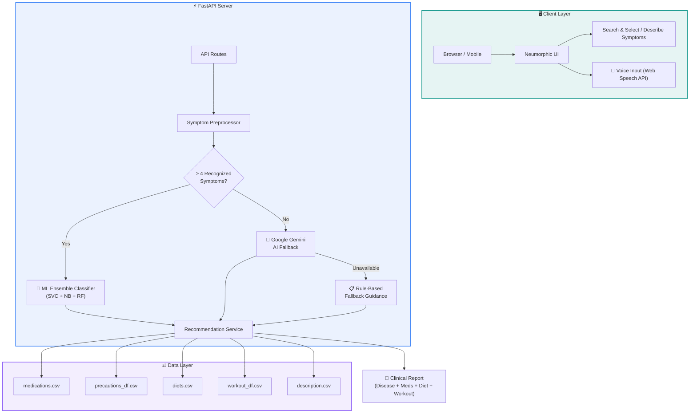

<!-- ═══════════════════════════════════ HERO TITLE ═══════════════════════════════════ -->

<h1 align="center">🩺 Swasthya Margadarshika</h1>

<p align="center">
  <strong>स्वास्थ्य मार्गदर्शिका — AI-Powered Clinical Decision Support Platform</strong>
</p>

<p align="center">
  <a href="#-features"></a>
  <a href="#-quickstart"></a>
  <a href="#-api-reference"></a>
  <a href="#-deployment"></a>
</p>

<p align="center">
  <sub>Machine learning symptom analysis · 132 symptoms · 41 conditions · Evidence-based guidance</sub>
</p>

---

<!-- ═══════════════════════════════════ TECH STACK SVG BADGES ═══════════════════════════════════ -->

<h3 align="center">⚙️ Tech Stack</h3>

<p align="center">
  
  
  
  
  
  
  
  
  
</p>

---

## 📖 About

**Swasthya Margadarshika** (स्वास्थ्य मार्गदर्शिका — "Health Guide") is a state-of-the-art clinical intelligence platform that modernizes personalized healthcare recommendations. The platform employs a high-precision **Ensemble Classifier** (SVC + MultinomialNB + Random Forest) trained on 4,920 clinical records to evaluate conditions across **132 physiological symptoms** and **41 recognized diseases**, supplemented by a **Google Gemini AI fallback** for handling colloquial or out-of-vocabulary symptom descriptions.

> [!NOTE]
> This is an **educational informatics platform** designed to demonstrate ML applications in healthcare. It is **not** a substitute for professional medical advice.

<br/>

---

## ✨ Features

### 🧠 Machine Learning Engine

<table>
<tr>
<td width="80" align="center">

```
🔬
```

</td>
<td>

**Ensemble Voting Classifier** — Soft-voting ensemble combining SVC (Linear Kernel), MultinomialNB, and Random Forest, trained on 4,920 records with 100% training accuracy for deterministic, reproducible predictions.

</td>
</tr>
<tr>
<td align="center">

```
🧬
```

</td>
<td>

**132-Dimension Feature Space** — Binary symptom vector mapping preserving exact column alignment with the training corpus. Handles normalization, whitespace cleanup, and alias resolution automatically.

</td>
</tr>
<tr>
<td align="center">

```
🎯
```

</td>
<td>

**41 Disease Classifications** — From common infections (Fungal, UTI, Malaria) to chronic conditions (Diabetes, Hypertension, Hepatitis), each with clinically referenced treatment guidance.

</td>
</tr>
</table>

### 🤖 Intelligent AI Fallback (Google Gemini)

<table>
<tr>
<td width="80" align="center">

```
💬
```

</td>
<td>

**Natural Language Understanding** — Describe symptoms in plain English (e.g., *"I've been having a terrible headache and feeling nauseous since morning"*). The system auto-extracts and maps to recognized medical terms.

</td>
</tr>
<tr>
<td align="center">

```
🔄
```

</td>
<td>

**Graceful Degradation** — If the AI service is unavailable, the system falls back to rule-based health guidance without crashing or fabricating diagnoses. Works fully offline with the ML model.

</td>
</tr>
<tr>
<td align="center">

```
⏱️
```

</td>
<td>

**Bounded Timeout** — Strict 8-second timeout with sanitization and Pydantic response validation to ensure fast, safe responses.

</td>
</tr>
</table>

### 💊 Comprehensive Health Recommendations

<table>
<tr>
<td width="80" align="center">

```
💉
```

</td>
<td>

**Top-5 Medications** — Retrieved from curated datasets, clearly labeled as educational/informational guidance.

</td>
</tr>
<tr>
<td align="center">

```
🛡️
```

</td>
<td>

**Preventive Precautions** — 4 actionable precautions per condition from `precautions_df.csv`.

</td>
</tr>
<tr>
<td align="center">

```
🥗
```

</td>
<td>

**Dietary Guidance** — Condition-specific nutritional recommendations from `diets.csv`.

</td>
</tr>
<tr>
<td align="center">

```
🏋️
```

</td>
<td>

**Workout & Lifestyle** — Physical activity recommendations tailored to the predicted condition.

</td>
</tr>
</table>

### 🎨 Neumorphic UI/UX Design

<table>
<tr>
<td width="80" align="center">

```
✨
```

</td>
<td>

**Premium Neumorphism Theme** — Soft shadows, recessed inputs, raised cards, and glassmorphism effects creating a modern, tactile interface. Built with a custom CSS design system on top of Bootstrap 5.3.

</td>
</tr>
<tr>
<td align="center">

```
🎤
```

</td>
<td>

**Voice Input (Web Speech API)** — Speak your symptoms using the built-in microphone button. Real-time speech-to-text with visual feedback.

</td>
</tr>
<tr>
<td align="center">

```
🔍
```

</td>
<td>

**Dual Input Modes** — **Search & Select** with real-time autocomplete, or **Describe Symptoms** in natural language with AI-powered extraction and confirmation workflow.

</td>
</tr>
<tr>
<td align="center">

```
📱
```

</td>
<td>

**Fully Responsive** — Optimized for desktop, tablet, and mobile with adaptive layouts, touch-friendly controls, and neumorphic micro-interactions.

</td>
</tr>
</table>

### 🔐 Security & Safety

<table>
<tr>
<td width="80" align="center">

```
🔒
```

</td>
<td>

**Authentication System** — Login/Register with session management. Protected routes ensure only authenticated users access the symptom checker.

</td>
</tr>
<tr>
<td align="center">

```
🚨
```

</td>
<td>

**Emergency Warnings** — Red banner alerts advising users with critical symptoms to seek urgent emergency care (911/112) immediately.

</td>
</tr>
<tr>
<td align="center">

```
🔑
```

</td>
<td>

**Environment-Based Secrets** — All credentials stored in `.env` via `pydantic-settings`. Automated tests verify keys never leak in responses.

</td>
</tr>
</table>

<br/>

---

## 🏗️ Architecture



<br/>

### 📁 Project Structure

```
swasthya-margadarshika/
├── 📂 app/
│   ├── main.py                          # FastAPI app factory, lifespan, CORS & routes
│   ├── 📂 core/
│   │   └── config.py                    # Centralized settings via pydantic-settings
│   ├── 📂 api/routes/
│   │   ├── health.py                    # GET /api/health — system status
│   │   ├── symptoms.py                  # GET /api/symptoms — 132 symptoms & search
│   │   ├── predictions.py               # POST /api/predict — ML prediction pipeline
│   │   └── pages.py                     # HTML page routes (Home, About, Profile)
│   ├── 📂 schemas/
│   │   ├── symptom.py                   # Symptom list & search schemas
│   │   └── prediction.py               # Request/response schemas (ML, AI, Clarification)
│   ├── 📂 services/
│   │   ├── prediction_service.py        # SVC inference engine
│   │   ├── recommendation_service.py    # CSV data retrieval with fuzzy matching
│   │   └── ai_fallback_service.py       # Google Gemini AI with timeout & validation
│   ├── 📂 ml/
│   │   ├── model_loader.py              # Singleton model & dataset loader
│   │   └── preprocessing.py             # Feature vectorization & symptom mapping
│   ├── 📂 templates/                    # Jinja2 HTML templates (Neumorphic design)
│   └── 📂 static/
│       ├── css/style.css                # Custom neumorphic design system
│       ├── js/app.js                    # Async symptom search, tags, TTS
│       └── images/                      # Static assets
├── 📂 models/
│   └── svc.pkl                          # Trained ensemble model (132 → 41)
├── 📂 datasets/                         # 7 clinical CSV datasets + Training.csv
├── 📂 tests/                            # Automated pytest test suite
├── requirements.txt                     # Python dependencies
├── Procfile                             # Gunicorn start command
├── render.yaml                          # Render deployment blueprint
├── .env.example                         # Environment template
└── README.md
```

<br/>

---

## 🚀 Quickstart

### Prerequisites

- **Python 3.10+** installed
- (Optional) **Google Gemini API Key** for AI fallback

### 1️⃣ Clone & Setup

```bash
# Clone the repository
git clone https://github.com/tulsikumar18/swasthya-margadarshika.git
cd swasthya-margadarshika

# Create virtual environment
python3 -m venv .venv
source .venv/bin/activate   # macOS/Linux
# .venv\Scripts\activate    # Windows
```

### 2️⃣ Install Dependencies

```bash
pip install -r requirements.txt
```

### 3️⃣ Configure Environment

```bash
cp .env.example .env
```

Edit `.env` with your configuration:

```env
APP_NAME="Swasthya Margadarshika"
APP_ENV=development
HOST=127.0.0.1
PORT=8000
DEBUG=false
SECRET_KEY=your_secure_random_key

# Optional: Enables AI fallback for unknown symptoms
GEMINI_API_KEY=your_gemini_api_key
```

> [!TIP]
> The system works fully **without** a Gemini API key using the ML model and rule-based fallbacks!

### 4️⃣ Run the Application

```bash
# Option A: Using the launcher script
python run.py

# Option B: Direct Uvicorn
uvicorn app.main:app --host 127.0.0.1 --port 8000 --reload
```

Visit **http://127.0.0.1:8000** in your browser 🎉

<br/>

---

## 📡 API Reference

### Endpoints

| Method | Endpoint | Description |
|:---:|---|---|
| `GET` | `/` | 🏠 Landing page with neumorphic symptom checker |
| `GET` | `/about` | ℹ️ How It Works & safety information |
| `GET` | `/profile` | 👤 User profile dashboard |
| `GET` | `/docs` | 📋 Interactive Swagger UI documentation |
| `GET` | `/redoc` | 📖 ReDoc API documentation |
| `GET` | `/api/health` | 💚 System health, model readiness, dataset metrics |
| `GET` | `/api/symptoms` | 📋 All 132 supported symptoms with display labels |
| `GET` | `/api/symptoms/search?q=` | 🔍 Real-time autocomplete search |
| `POST` | `/api/predict` | 🧠 JSON prediction endpoint |
| `POST` | `/predict` | 📝 Form-based prediction with HTML response |

### Example Request

```bash
curl -X POST "http://127.0.0.1:8000/api/predict" \
     -H "Content-Type: application/json" \
     -d '{
       "symptoms": ["high_fever", "headache", "vomiting", "chills"],
       "allow_ai_fallback": true
     }'
```

### Example Response

```json
{
  "success": true,
  "mode": "ml_prediction",
  "predicted_disease": "Malaria",
  "description": "Malaria is a mosquito-borne infectious disease...",
  "medications": ["Chloroquine", "Artemisinin", "Quinine", "..."],
  "precautions": [
    "Consult nearest hospital",
    "Avoid oily food",
    "Avoid non-veg food",
    "Keep mosquitoes out"
  ],
  "diet_recommendations": ["..."],
  "workout_recommendations": ["..."],
  "recognized_symptoms": ["high_fever", "headache", "vomiting", "chills"],
  "message": "Based on your symptoms, our ML model identified Malaria.",
  "disclaimer": "This is not a substitute for professional medical advice..."
}
```

<br/>

---

## 🧪 Testing

The project includes a comprehensive automated test suite covering:

- ✅ Application startup & graceful shutdown
- ✅ System health checks & model readiness
- ✅ Template rendering & navigation
- ✅ Valid ML predictions & recommendation lookups
- ✅ Duplicate symptom handling & alias normalization
- ✅ Empty/invalid symptom validation
- ✅ Minimum 4-symptom enforcement
- ✅ AI fallback with simulated responses
- ✅ Graceful offline fallback
- ✅ Credential leak prevention

```bash
# Run all tests
pytest -v

# Run with coverage
pytest -v --tb=short
```

<br/>

---

---

## 📊 Datasets

| Dataset | Records | Purpose |
|---|:---:|---|
| `Training.csv` | 4,920 | Primary ML training data (132 symptoms → 41 diseases) |
| `symtoms_df.csv` | — | Symptom-disease mapping reference |
| `Symptom-severity.csv` | — | Symptom severity weights |
| `description.csv` | 41 | Disease descriptions |
| `medications.csv` | 41 | Top-5 medications per condition |
| `precautions_df.csv` | 41 | 4 precautions per condition |
| `diets.csv` | 41 | Dietary recommendations |
| `workout_df.csv` | — | Exercise & lifestyle guidance |

<br/>

---

## 🛡️ Medical Disclaimer

> [!CAUTION]
> This software is an **experimental, educational informatics platform** designed to demonstrate machine learning applications in healthcare. It is **NOT clinically certified** and must **NOT** be used for:
> - Clinical diagnosis or treatment decisions
> - Emergency medical care
> - Replacing professional medical advice
>
> **If you are experiencing serious or worsening symptoms, consult a qualified physician or contact emergency services (911 / 112) immediately.**

<br/>

---

## 👨‍💻 Developer

<p align="center">
  <strong>Tulsi Kumar Yadav</strong><br/>
  <sub>Full Stack Developer · ML Engineer</sub>
</p>

<p align="center">
  <a href="https://www.linkedin.com/in/tulsi-kumar-yadav-2b749627a">
    
  </a>
  <a href="https://github.com/tulsikumar18/">
    
  </a>
  <a href="https://leetcode.com/u/TULSIKUMARYADAV/">
    
  </a>
  <a href="mailto:swasthyamargadarshika@gmail.com">
    
  </a>
</p>

<br/>

---

<p align="center">
  <sub>© 2026 Swasthya Margadarshika. All rights reserved.</sub><br/>
  <sub>Made with ❤️ by <a href="https://github.com/tulsikumar18/">tulsikumar18</a></sub>
</p>

<p align="center">
  
</p>
